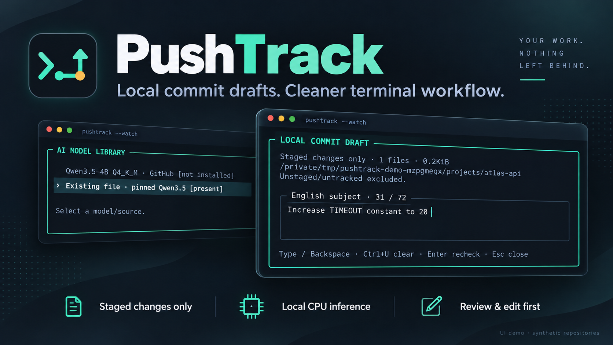
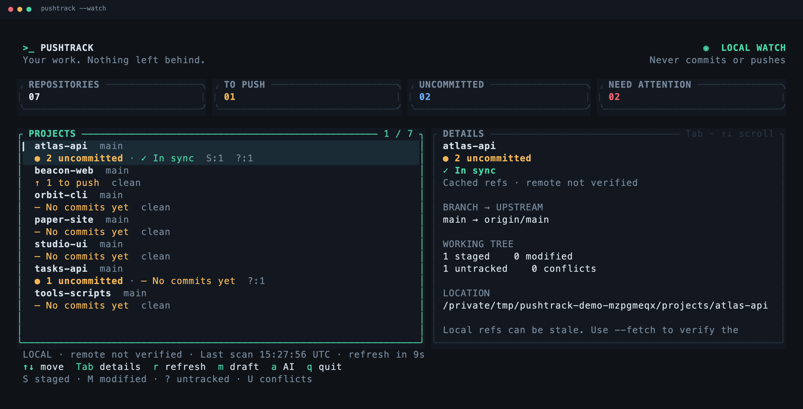
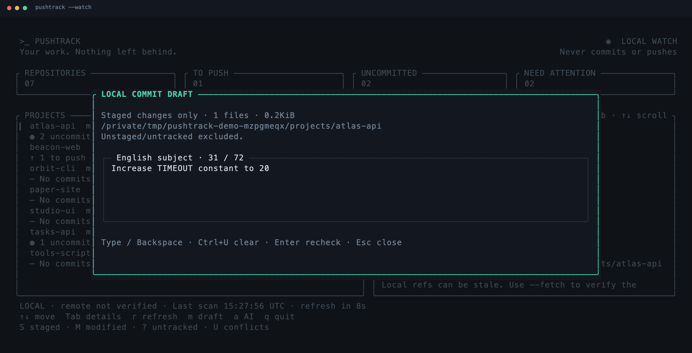
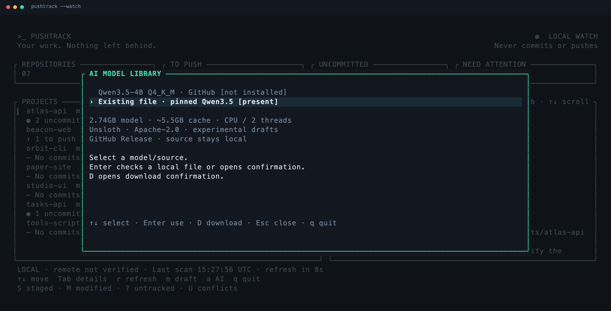

<p align="center">
  
</p>

<h1 align="center">PushTrack</h1>

<p align="center">Your work. Nothing left behind.</p>

A colorful **Rust + Ratatui** terminal dashboard for the question: **“Did I push it?”**

Track repositories across multiple folders, spot unpushed commits, and inspect uncommitted changes without leaving your terminal. Optionally press **`m`** to generate an **editable English commit-subject draft from staged changes**, entirely on your machine. Works independently of Pi, your editor, or any coding agent.

**PushTrack never commits, pushes, pulls, checks out, or resets anything.** Git network access is opt-in with `--fetch`; model downloads require separate TUI confirmation. All application messages are in English.

## New: local commit drafts + a clearer interface



*Promotional illustration; the actual terminal views below use synthetic demo repositories.*

- **Press `m`, review, edit.** Draft an English subject from staged changes with local, pretrained Qwen3.5-4B. No cloud inference, automatic staging, commits or pushes.
- **Press `a` to manage the model.** Explicit download consent, pinned hashes, progress and cancellable/resumable acquisition.
- **A focused TUI.** Consistent modal spacing, stronger headings, readable controls and a dimmed dashboard behind the active window. The normal project list returns on close.
- **You stay in control.** AI never runs during scans or refreshes; larger contexts require explicit approval. Drafts remain experimental and need your review.

[Set up local drafts](#local-commit-message-drafts-experimental) · [Install PushTrack](#install)

## The dashboard



*Actual CLI output rasterized from its terminal buffer, using synthetic local repositories.*

```bash
pushtrack --fetch --watch
```

Watch mode opens a dedicated full-screen terminal interface instead of printing an ever-growing list:

- A dark, mint-accented layout with summary cards and color-coded Git states.
- A scrollable project list with a clearly highlighted selection.
- A details panel for the selected repository's branch, upstream, files, path, and errors.
- Background Git checks: keyboard navigation and quitting remain responsive during fetch.
- Side-by-side panels in wide terminals, stacked panels in narrower windows.
- Selection preserved across refreshes, including when the folder list changes.
- The previous terminal screen, cursor, and input settings restored on exit.

| Key | Action |
| --- | --- |
| `↑` / `↓` or `k` / `j` | Select a project; scroll when the details panel is focused |
| `Page Up` / `Page Down` | Move a page |
| `Home` / `End` | Jump to the first/last project or the top/bottom of details |
| `Tab` / `Shift+Tab` | Switch between projects and details |
| `r` | Refresh now; does not start overlapping scans |
| `a` | Open AI model/source selection (explicit download confirmation, progress, cancellation) |
| `m` | Generate an editable local English subject for all staged text changes in the selected repository |
| `q` | Quit the dashboard (types `q` while editing a subject) |
| `Ctrl+C` | Exit and cancel active Git/model processes |

At least **60 columns × 18 rows** is recommended. The dashboard is most comfortable at **110+ columns**. No separate GUI window is opened; it uses your terminal's alternate screen buffer.

## Install

Requirements:

- **Rust 1.88+** and Cargo, available through [rustup](https://rustup.rs/).
- **Git 2.40+** on `PATH`.
- A macOS or Linux terminal. The current release has been tested on macOS; Windows is not supported.

```bash
git clone https://github.com/TemelGunaydin/PushTrack.git
cd PushTrack
./scripts/install.sh
```

The installer uses `cargo install --locked` to build and install the executable at `~/.local/bin/pushtrack`. It requires no `sudo` and does not change your shell configuration.

If needed, add this line to `~/.zshrc` or your shell's configuration:

```bash
export PATH="$HOME/.local/bin:$PATH"
```

A custom installation prefix is supported:

```bash
PREFIX="$HOME/tools" ./scripts/install.sh
```

To run without installing:

```bash
cargo run --locked -- --help
cargo run --locked -- --fetch --watch
```

## Track any folders

Add individual repositories or parent folders containing projects:

```bash
pushtrack add ~/Projects ~/Work /Volumes/External/Repos
pushtrack list
```

Then check your saved folders from anywhere:

```bash
pushtrack                         # One-off local report
pushtrack --fetch                  # One-off report with upstream checks
pushtrack --watch                  # Interactive local dashboard
pushtrack --fetch --watch          # Interactive dashboard with upstream checks
```

Remove a folder without deleting its files:

```bash
pushtrack remove ~/Work
```

Explicit paths are scanned once without modifying your saved list:

```bash
pushtrack ~/SideProjects /path/to/another/repo --fetch
pushtrack "/path/with spaces/project" --watch
```

Without explicit paths, PushTrack uses saved folders. If none are saved, it scans the current directory. There is no hardcoded `~/Projects` default.

Folder settings are stored in `$XDG_CONFIG_HOME/pushtrack/config.json`, or `~/.config/pushtrack/config.json` when `XDG_CONFIG_HOME` is unset or not absolute. Writes are atomic; malformed configuration is reported rather than overwritten.

**Updating:** re-run the installer to replace an older executable. Existing saved-folder settings remain compatible and do not need conversion.

## Local commit-message drafts (experimental)

The local draft workflow is implemented: model selection/download confirmation,
complete staged-input collection, explicit context approval, editable subjects,
snapshot rechecks and cancellation. **Generation starts only when you press `m`**;
scanning or refreshing never runs AI. Subjects are English and at most **72 characters**;
review and edit them before using them in your own commit workflow.

**Model provenance:** PushTrack uses the pretrained **Qwen3.5-4B** model in the
pinned Unsloth Q4_K_M GGUF format. It is **not a newly trained or fine-tuned PushTrack
model**. Earlier CodeT5 training was separate research and is not used by the app.
This remains an editable-draft prototype, not a guarantee of faithful messages.



*Actual draft-dialog UI. The example subject comes from a fake demo transport; no model was run for this capture. Unstaged/untracked files are excluded.*

AI is **optional and on demand**. Bring these local
assets; Python/runtime installation is manual. Model acquisition is either manual
or an **explicitly confirmed** TUI download (publication status below):

- **Python 3.11+**. The connector uses only the standard library and is embedded
  in the Rust executable; no separate Python script installation is needed.
- **Qwen3.5-4B Q4_K_M**, **2,740,937,888 bytes**, from the pinned
  [Unsloth quantization](https://huggingface.co/unsloth/Qwen3.5-4B-GGUF/tree/e87f176479d0855a907a41277aca2f8ee7a09523).
  File: `Qwen3.5-4B-Q4_K_M.gguf`. The SHA-256 below is checked before loading:
  `00fe7986ff5f6b463e62455821146049db6f9313603938a70800d1fb69ef11a4`.
- A trusted **llama-server b11429** built for **your macOS/Linux architecture**,
  source commit `d81235049384534c167caea52b85a694f6103d14`, from
  [llama.cpp](https://github.com/ggml-org/llama.cpp/releases/tag/b11429).
  Runtime revision is checked. A Windows `.exe` cannot be used by the Mac/Linux dashboard.
  The connector explicitly disables GPU offload, tools/agents, downloads and UI.

The model declares **Apache-2.0** and runtime **MIT**; retain their license notices
if redistributing assets. The model is a third-party Unsloth GGUF, not an official
Qwen quantization. No research-trained CodeT5 weights are bundled.

```bash
pushtrack /path/to/repo --watch \
  --ai-model /path/to/Qwen3.5-4B-Q4_K_M.gguf \
  --ai-server /path/to/llama-server \
  --ai-python /path/to/python3.12
```

`--ai-python` is optional (defaults to `python3`). `--ai-model` can be omitted
when the verified managed model is installed; `--ai-server` can be omitted when
your trusted native `llama-server` is on `PATH`, or the previously verified Mac
ARM64 b11429 installation is in its supported user-cache location. These flags require `--watch`
and do not change saved folder settings. Without a model, `m` opens the library.

### TUI model setup



*Actual model-library UI using a placeholder local file. “Present” is file presence, not a successful hash verification or inference. [Image provenance](assets/README.md).*

Press **`a`** to open the mint-accented model library. Use ↑↓ to select the
managed model or an existing `--ai-model` file; **Enter verifies SHA-256** before
selecting an existing file. During **local SHA-256 checking**, the byte counter
reports local disk reads, not a download. Once Ready, **Enter/Esc returns to the
dashboard** instead of verifying again; then press `m`. Only the selected Qwen3.5 model is offered: the other
research candidates failed the development gate.

For the managed model, **D/Enter opens confirmation; another D/Enter confirms**.
A real byte-based progress gauge shows download size, speed and ETA, then
part/full-file SHA-256 verification and assembly. **Esc cancels**, keeping partial
files; a later explicit request can resume using validated HTTP206 ranges. No
automatic retry, model process, Git write, source upload or refresh-time download.
Requires `curl` and **~7.5GB free disk** including reserve. Verified parts and
upstream license/notices are retained: the completed cache uses ~5.5GB at
`$XDG_CACHE_HOME/pushtrack/models/qwen35-4b-q4km-v2`, or `~/.cache/...` if unset or
not absolute. Invalid cache files are reported, never silently replaced.

**Model hosted on GitHub:** [Qwen3.5-4B Q4_K_M asset release](https://github.com/TemelGunaydin/PushTrack/releases/tag/model-qwen35-4b-q4km-v2).
Six raw byte parts (maximum **512MiB**) reconstruct the exact pinned model; all
11 release assets passed size/SHA-256 reconciliation. The TUI downloader is enabled.
Actual public HTTPS acquisition through the Mac dashboard passed explicit Esc
cancellation, HTTP206 resume with exact prefix preservation, full assembly/hash,
and license checks on a synthetic repository—**no model inference or Git writes**.
Python and compatible llama-server still need manual setup. The old failed v1 draft
is preserved separately. [Publication/download evidence](ml/experiments/0023-model-store-publication.md).

1. **Stage the intended changes yourself.** Select the repository and press `m`.
   Capacity is measured on demand; approve a larger context only if requested.
2. Only the **entire staged Git index diff** is used. Unstaged/untracked files are
   **not included**. No automatic staging, commit or push occurs.
3. Review the subject; type/Backspace to edit, or `Ctrl+U` to replace it.
4. `Enter` rechecks the staged diff, HEAD and branch. A changed snapshot is rejected.
   Copy the reviewed subject manually for your own commit workflow.
5. `Esc` closes/cancels. `Ctrl+C` exits. Owned Python/server processes are stopped,
   including descendants, and model memory is released. Drafts are not persisted.

Conflicts, binary files, symlinks/submodules, unsupported encodings/control content,
and oversized input are refused **without omitting files or truncating the diff**.
Limits: **4MiB complete input**, with **4,096 tokens as the default CPU context**
and a **192-token output reservation**. `m` shows staged file/byte counts and measures
**the entire prompt (including the literal line-role audit)**. If it does not fit,
a capacity dialog shows exact tokens and the minimum supported larger context:
8,192, 16,384, 32,768, 65,536, 131,072 or 262,144. **Enter explicitly approves** that larger
CPU job; Esc declines. For an oversized default prompt, no completion or
larger-context allocation occurs before confirmation. Snapshot is checked again before the confirmed job.

Larger contexts consume more RAM/time and have **unverified long-diff quality and
performance**. Each owned job keeps its **300s ceiling**; completion uses only
remaining job time instead of a separate 120s allowance. Startup 120s/preparation 60s
caps remain; errors identify the timed-out endpoint/stage, with no automatic retry.
A prompt beyond 262,144 tokens (including output reservation) is refused, not shortened. Unsupported control
bytes remain refused. The installed experimental CLI now uses **lossless source
token boundaries**, preserving literal bytes while excluding all 33 reserved source
IDs; 44 synthetic native token-only cases passed. A three-case generation probe
produced two accepted drafts and one existing internal-summary output-gate refusal.
The input correction is installed; that separate output gate remains unchanged.
This is not broad semantic-quality or long-context clearance.
Its 128 combined-chunk budget refuses excess without omission. Do not
sanitize or omit source to bypass any gate.
[Capacity proof](ml/experiments/0027-draft-capacity.md) ·
[Literal-token mechanics/limits](ml/experiments/0030-lossless-literal-token-boundaries.md) ·
[Small generation probe/refusal](ml/experiments/0031-literal-input-generation-probe.md) ·
[Literal-token installation](ml/experiments/0032-literal-token-cli-installation.md) ·
[Bounded timeout update and verification](ml/experiments/0033-bounded-timeouts-and-modal-focus.md).

All draft and model-library states use consistent heading hierarchy, inset spacing
and shorter explanations. An open modal dims the dashboard behind it; the active
window stays readable and the normal project list returns when it closes. Model
consent, progress, license/runtime notices, staged scope and explicit larger-context
approval remain visible, including in 60 × 18 terminals.

Rename detection is disabled so both old/new paths
and their complete text remain explicit. No remote inference or source uploads;
only a temporary owned loopback CPU server is used.

**Resource tradeoff:** one small staged addition on native Windows took **19.33s**
for the connector (model-hash check, fresh server startup and generation), with
**4.55GB / 4.24GiB sampled aggregate working set** across owned Python/C++ processes.
This Windows measurement is not a whole-dashboard peak or latency distribution.
A separate **Mac ARM64 / 64GiB RAM** actual-dashboard synthetic test passed:
**17.77s** from `m` to editable subject and **5.99GB / 5.58GiB sampled aggregate RSS**
(Rust + Python + C++). Edit/review, stale-index refusal, Esc and Ctrl+C cleanup passed.
It is one small, cache-warm example, not broad latency/accuracy or Linux proof; RSS
and Windows working-set measurements are not directly comparable. Runtime setup
is manual and drafts remain experimental. [Mac setup/test evidence](ml/experiments/0024-mac-native-drafts.md).

The model passed a limited reused development gate, not a general accuracy
certificate. It can still misdescribe edits: **always review the wording**.
[Implementation and verification evidence](ml/experiments/0021-pushtrack-local-drafts.md).

## Reading Git status

| Status | Meaning |
| --- | --- |
| Mint `✓ In sync` | Current branch and its upstream reference are equal |
| Amber `↑ … to push` | Local commits are ahead of the upstream reference |
| Blue `↓ … behind` | The branch is behind its upstream reference |
| Red `↕ … diverged` | Both sides have commits missing from the other |
| Amber `—` / `!` / `?` | No upstream, no commits, detached HEAD, or missing upstream ref |
| Red `! Check failed` | Git or remote verification failed; do not assume synchronization |

Working-tree counts are separate from branch status:

- `S`: staged files.
- `M`: modified but unstaged files.
- `?`: untracked files, excluding ignored files.
- `U`: merge conflicts.

Repositories with uncommitted files prominently show **`● N uncommitted`** in amber (red for conflicts), independently of their branch's push status. `In sync` only means the committed history matches the upstream; it does **not** mean the working tree is clean.

One file can contribute to both `S` and `M`, but is counted once in the uncommitted total. “Uncommitted” in the summary cards counts repositories with changes. “Need attention” includes uncommitted work, repository issues, and scan warnings; switch to Details to read warnings.

### Cached information is not remote verification

Without `--fetch`, PushTrack reads local metadata only. A cached `origin/main` can be stale: **a green local result does not prove the server is synchronized now**.

`--fetch` refreshes the current branch's configured upstream. A successful check shows its timestamp in UTC. Authentication errors, timeouts, unavailable remotes, and deleted upstream branches are never displayed as verified green results.

An upstream pointing to another local branch is labeled as local during fetch checks. Fetch verification reflects a point in time; someone else can change the remote afterward.

### Safety and scope

- Only the **current branch** is compared with its **configured upstream**. Other branches, tags, stashes, and alternate push destinations are not checked. `pushRemote`, `remote.pushDefault`, separate push URLs, and custom push refspecs may send commits somewhere else; that destination is not verified here.
- `--fetch` downloads Git objects and updates only the relevant remote-tracking ref. It does not modify local branches, the index, or working-tree files. Tag fetching, submodule recursion, and automatic maintenance are disabled. Custom refmaps cannot update extra refs.
- Without `--fetch`, no remotes are contacted. Optional index writes and filesystem-monitor hooks are disabled during status checks.
- Existing Git credentials, `core.sshCommand`, and SSH configuration are respected. Interactive credential prompts are disabled. Each Git subprocess has a **20-second timeout**; private repositories need working non-interactive authentication.
- Cancellation terminates the owned Git process group, including transport and credential helpers.
- PushTrack launches Git without a shell. Git itself may run configured hooks or helpers; only inspect repositories you trust.

## Discovery, refresh, and colors

Discovery searches each selected folder and up to **two directory levels below it**. It stops descending when it finds a repository. Add deeper or nested repositories explicitly. Ordinary repos and linked worktrees are supported; bare repositories are not listed.

Hidden directories and common dependency/build directories are skipped. Symlinked child directories are not followed, but explicit symlink paths are resolved. Overlapping roots are deduplicated. Missing folders produce warnings, not silent omissions.

Watch mode refreshes every **10 seconds**, or **60 seconds with `--fetch`**, measured after each scan finishes. It reloads saved folders each cycle, so `add` and `remove` can be used from another terminal. Refreshing uses the same fetch mode as the original command.

```bash
pushtrack --color always          # Force colors
pushtrack --color never           # Plain one-off output
pushtrack --watch --color never   # Monochrome TUI, still keyboard-driven
NO_COLOR=1 pushtrack              # Disable automatic colors
pushtrack > status.txt            # Plain text automatically
```

`--watch` requires interactive stdin and stdout and is not supported with pipes or `TERM=dumb`. One-off reports remain pipe-friendly. Explicit `--color always` overrides automatic detection. Monochrome watch mode still uses terminal control sequences for layout and selection.

For paths beginning with a dash or matching a command name:

```bash
pushtrack -- ./-project
pushtrack ./add
```

## Model research and provenance

The separate [ML research](ml/README.md) includes CodeT5 training experiments and
local pretrained-model comparisons. **The app's selected Qwen3.5-4B model received
no PushTrack training or optimizer updates.** Research-trained CodeT5 weights,
datasets and checkpoints are not bundled with the application.

In 20 repeatedly reused development cases, Qwen3.5 produced 18 usable drafts and
two needing editing; 12 synthetic core-change cases passed. This is limited,
unblinded evidence, not independent human gold or population accuracy. The
[CPU connector and fresh reload proof](ml/experiments/0020-verified-local-draft-model.md)
underpin the experimental on-demand `m` action, not unattended inference or commits.
Long-context completion, accuracy and resource guarantees remain unverified.

The separate 100-epoch CodeT5 run was user-stopped during epoch 72, with **71 measured
epochs/checkpoints preserved**. It was not completed, promoted or restarted. No
research-trained weight distribution or Windows dashboard support is claimed.

## Development and tests

```bash
cargo fmt --all --check
cargo clippy --all-targets -- -D warnings
cargo test --locked
cargo build --release --locked
```

Tests cover temporary local Git remotes, push/ahead/behind/diverged states, stale and deleted refs, fetch failures, worktree preservation, custom refmaps, conflicts, renames, worktrees, configuration compatibility, CLI output, keyboard selection, and bounded dashboard layouts.

The optional real-terminal acceptance suite uses Python, [uv](https://docs.astral.sh/uv/), and an isolated `pyte` dependency:

```bash
cargo build --release --locked
uv run --no-project --with pyte scripts/test_tui.py target/release/pushtrack
```

It checks alternate-screen behavior, arrows, paging, resize, detail scrolling,
refresh, monochrome output, terminal restoration and navigation/quit during a
blocked fetch. Fake transports exercise staged-only drafts, editing/revalidation,
stale-index refusal, explicit capacity approval, endpoint timeout display and owned
model cancellation, plus model download consent/progress/retained partials. Render
tests cover all six draft states, five model states and three asset-progress phases,
including hierarchy/spacing, dim backgrounds and undimmed foregrounds at supported
sizes. The current application passed **65 Rust tests** and **41 synthetic/mocked
connector tests**; the installed binary passed the full fake-transport PTY suite.
Actual small synthetic-model inference proofs are separate, on Windows and Mac
ARM64. Routine tests use temporary repositories and do not contact GitHub, run a
real model or modify your projects.

### Exit codes

- `0`: completed, or quit the dashboard with `q`. Pending commits are not execution errors.
- `1`: configuration, discovery, or Git/fetch failure; no repositories found; unavailable interactive terminal.
- `2`: invalid command-line syntax.
- `130`: interrupted with Ctrl+C/SIGINT.
- `143`: terminated with SIGTERM.

Watch mode continues after per-repository or configuration errors so the next refresh can retry.
